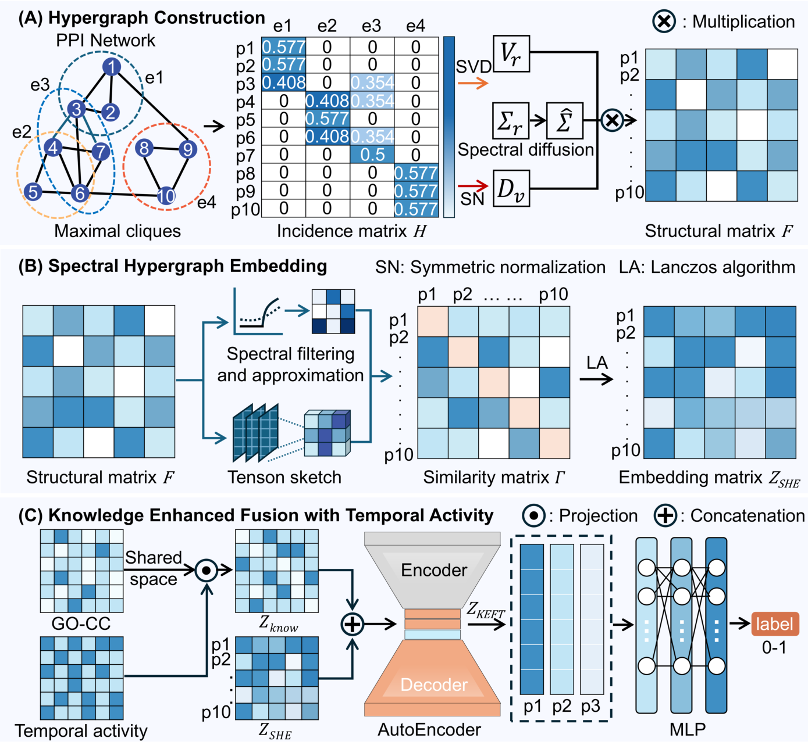
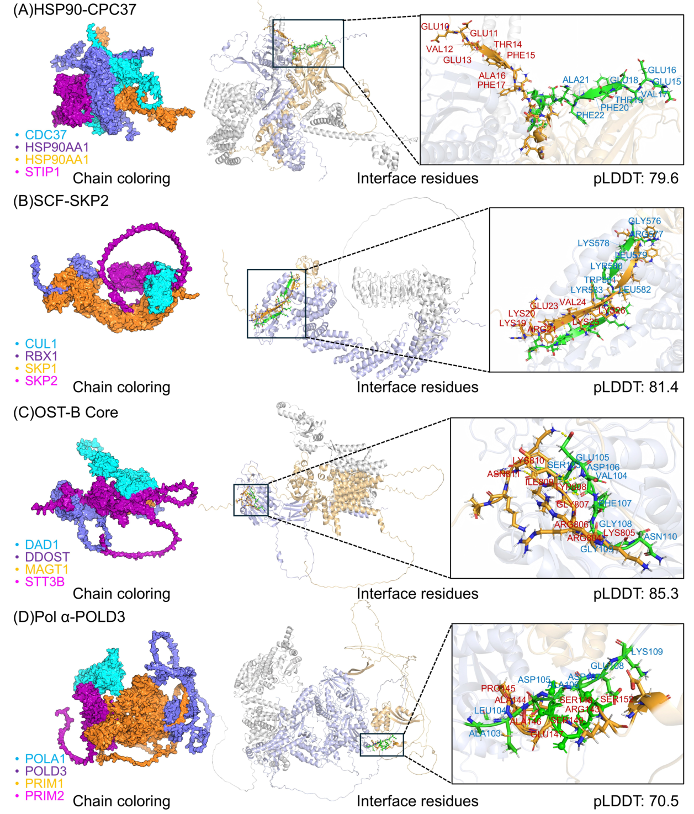
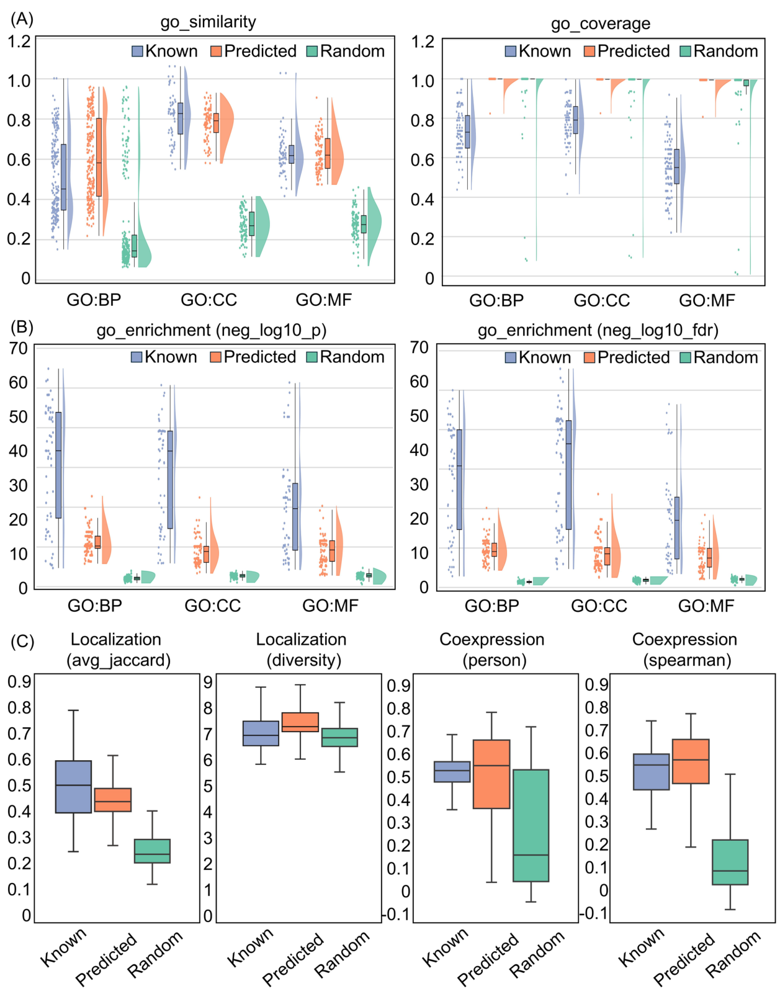

# 样例：用 KSHL-PC 把七站讲具体

这是一篇生命科学与 AI 交叉论文的完整讲法参考：生物学问题决定计算对象，
计算方法产生可检验的预测，实验与证据决定能下什么结论。借鉴讲解粒度，
不把这篇的维度、阈值、数据与机制当成其他论文的默认设置。

材料与定位：

- 论文：Knowledge-Augmented Spectral Hypergraph Learning for Protein Complex Identification in Network-Based Drug Discovery，DOI `10.1109/JBHI.2026.3695893`。
- 本次依据用户提供的 10 页 IEEE JBHI 已接收作者版本；不包含其引用的补充图表。
  PDF SHA256：`b16e545d217fa1586172a0f6a7b9947112d73e0dcae80201d6c0801cdf064cac`。
- [作者代码](https://github.com/weiyu1218/KSHL-PC/tree/91f2397d66403979023348d8cffa396755f7e333)，
  核对日期 2026-10-08，固定提交 `91f2397d66403979023348d8cffa396755f7e333`。
  此处是静态核对，没有训练模型或复现论文指标。
- 数据文件不在 Git 仓库中，README 另给下载入口；本例未取得原始数据、权重与补充材料。
  本文的 GO 列数、真实样本逐行值、最终选定超参数与各候选预测分数不能补造。
- 下列三张图来自上述 PDF 的图 1、2、3，分别位于 PDF 第 4、7、9 页。
  在会话中发图时，按指南使用宿主支持的图片展示方式；支持本地路径时，
  把相对地址解析为当前技能实际目录下已核实的绝对路径，不直接照抄相对链接。

数值来源分四类，讲解时沿用这些标签：**原文事实**、**代码事实**、
**原图/公式复算**、**教学设定**。建议实验标成**待检验设想**。
原图的 p1-p10 是示意节点，没有真实蛋白名；教学数值也不对应真实蛋白。

七站目录：1 动机与生物学问题；2 方法架构；3 训练与目标；4 数据与样本；
5 信息流；6 具体例子走一遍；7 实验、证据、局限与研究空白。
另有两种互动示范：解释卡点与纠正复述。

本页是备课材料，每节可拆成多轮，不一次倾倒全部事实。先定位对应原文并概括
当前问题，再补背景、演算和回读。贯穿对象用论文报告的
`S={POLA1,PRIM1,PRIM2,POLD3}`：动机解释为何判断整个集合，架构和训练指出它
在哪里被评分，数据站定位成员 ID 与表示行，信息流站追踪集合接口，案例站回到
输出证据。原始数据和权重缺失处明确留白；图中 p1-p10 与局部教学向量是另外
标明的演算对象，不能把它们当作 S 的真实节点、嵌入或中间输出。

## 1 动机与生物学问题：要找的是集合，而不只是两两互作

**基本情况。** Feng 等的 KSHL-PC，用户提供的是 IEEE JBHI 已接收作者版本，
DOI 年份为 2026；首页列有 Wenzhou University of Technology、
Shenzhen University of Information Technology 等作者机构。
代码公开，数据另给下载入口；没有据此确认每项数据、权重都已实际可用。
输入是 PPI 网络、GO-CC 注释与时间表达特征；输出是候选蛋白集合的复合物评分，
以及经挖掘得到的复合物集合。路线按本页七站展开。

**这篇真正做的任务是什么？** 给定很多蛋白及它们的两两互作记录，判断哪些
蛋白集合像一个共同工作的复合物。它不直接预测药物疗效；药物发现是下游愿景。
依据：摘要、II.B 与 IV，PDF 第 1、3、9 页。

原文的人类案例给出一个非常具体的问题：候选集合
`{POLA1, PRIM1, PRIM2, POLD3}` 是否有生物学依据？
作者把它称为 Expanded 案例，并提出 POLD3 替代 POLA2 的解释
（III.D，第 7-8 页，图 2D）。这个成员集合是论文报告的预测；
“替代”是否真实发生，还需要相应实验，不能从集合名字直接读出来。

作者的设计如何对应问题：

| 问题 | 论文的做法 | 尚未解决的距离 |
|---|---|---|
| 目标是多个蛋白共同组成的集合，PPI 是两两记录 | 把 maximal clique 转成超边 | 密集互作是高阶建模代理，不等于实验观察到同时组装 |
| 需要利用集合内与集合间的结构联系 | SHE 的有限步谱扩散与低秩表示 | 嵌入距离不直接说明具体的分子机制 |
| 组装还与空间和时间条件有关 | GO-CC 与时间活动特征进入 KEFT | 定位注释和表达代理不证明同一条件下发生物理组装 |
| 需要判断整个候选集合 | 成员表征平均池化，再用分类器评分 | 高分需要评价与验证，不能自动变成确认的复合物 |

一句话回顾：这篇把“哪些蛋白可能共同组装”变成结合网络结构与生物知识的集合判别任务。
下一站：对着图 1 看每一层怎样改变数据。继续吗？

为什么这样讲：从实际成员集合出发，每个技术选择都回答一个生物学困难，
同时说明模型表示与生物事实之间还差什么证据。

## 2 方法架构：先分清蛋白级表征与集合级评分

接着候选集合 S 的问题，先读原文 II.C-F 与图 1：作者需要先为网络中的蛋白形成
数值表示，再把候选成员的表示合成集合表示。下面为原文概括，先看两级对象在哪里
切换；不要求用户已经知道谱分解或自编码器，相关运算在后续逐步展开。



这张图从上到下有 A、B、C 三块：A 从 PPI 和极大团建立结构矩阵；
B 进行过滤、近似与谱分解，得到每个蛋白的结构表示；C 把 GO-CC、时间活动
与结构表示接起来，经自编码器形成融合表示，再给集合评分。
图里的 p1、p2 是示意蛋白节点，不是预测类别。图 C 的 label 0-1 对应复合物标签。

**原文符号**：n 是蛋白数，m 是超边数，r 是截断 SVD 秩，k 是 SHE 输出维度，
q 在本例中表示 GO-CC 列数，T_time 是时间窗数，dz 是融合输出维度。
这里用 q 避免把论文复用的 p（GO 列数/多项式阶数）混在一起。

| 模块 | 吃什么 | 吐什么 | 生物学含义与训练状态 |
|---|---|---|---|
| 极大团转超边 | 两两 PPI，n 个节点 | 二值 H，m x n | 构造密集蛋白集合的高阶结构代理；固定算法 |
| SHE | 归一化 H | Z_SHE，n x k | 每个蛋白的结构坐标；数值分解、滤波与近似，不是分类器梯度训练 |
| 知识特征 | GO-CC 与表达时间序列 | Z_know，n x (q+T_time) | 空间注释与活动代理；按实际规则编码和标准化 |
| 融合自编码器 | X，n x (k+q+T_time) | Z_KEFT，n x dz | 学紧凑联合表示；第一阶段用重建损失训练 |
| mean pooling | 某候选集合 S 的成员行 | z_S，1 x dz | 把多个蛋白的表征变成一个集合表征；顺序改变不改变均值 |
| MLP + sigmoid | z_S | 一个分数 p(S) | 第二阶段分类器学习；监督标签属于集合 |

依据：II.C-F，第 3-6 页，式 (1)-(27)。自编码器并不直接输出复合物概率，
均值池化也不要求所有候选具有相同成员数。

**必须指出图与公式的差异。** 图 1A 的表画成蛋白行、超边列，并显示归一化值；
式 (1) 的 H 定义为超边行、蛋白列且是 0/1，式 (3) 才定义归一化。
代码 `src/she_embed.py:7-19` 按式 (1) 构造 m x n 的二值矩阵。
后续演算以正文/代码方向为准，并说明原图显示的是转置后的归一化表。

为什么这样讲：先给输入输出与行列含义，再谈算法；用户能看清模型在何处
从“一个蛋白一行”转为“一个候选集合一行”。

## 3 训练与目标：重建特征与识别集合是两个阶段

先接上架构：每个蛋白已经有一行表示，但系统还要判断一个成员集合是否像复合物。
带着两个问题读 II.F，第 6 页：怎样学习蛋白表示，又怎样学习整个集合的判别？
这里的重建是让输出接近输入表示，分类则让预测接近集合标签，两者的监督来源不同。

**原文事实。** 式 (26)-(27) 明确规定：

1. Stage 1：自编码器重建输入 X，用 L_AE 训练编码器和解码器。
2. Stage 2：固定编码器，用融合表示训练集合分类器，优化 BCE；
   分类损失不回传到融合自编码器。

```
L_AE = sum((X_hat - X)**2) / (n*d)
z_S = mean(Z_KEFT[i, :] for i in S)
L_cls = -mean(y*log(p) + (1-y)*log(1-p))
```

| 符号 | 是什么 | 形状或取值 |
|---|---|---|
| X / X_hat | 原输入 / 重建输入 | n x d，d=k+q+T_time |
| Z_KEFT | 融合后的蛋白表示 | n x dz |
| S / y | 候选成员集合 / 集合标签 | 可变大小 / 0 或 1 |
| p | 分类器对候选的 sigmoid 输出 | 每个集合一个数，0 到 1 |

**教学设定，逐项演算。** 把一条输入暂缩成 `[1,0]`，重建为 `[0.8,0.1]`，
两维的平均平方误差是 `(0.2**2+0.1**2)/2=0.025`。
这里重建的是表示，不是蛋白复合物的真实成员表。
再假设一个正样本集合得分 0.8、一个负样本得分 0.3，
两者平均 BCE 为 `(-log(0.8)-log(0.7))/2=0.289909`。
这些是公式代入值，没有运行 KSHL-PC 得到这两个预测。

**代码事实。** `src/fusion.py:79-99` 用 MSE 训练自编码器，并在 no_grad 中
取得融合表示；`src/Train_PC.py:15-27` 的优化器只有 PCpredict 参数。
因此不能照抄摘要里的“端到端”就讲成 BCE 一路训练 SHE、自编码器和分类器。
SHE 的低秩分解、重建损失、集合监督三件事要分别说明。

为什么这样讲：小数字解释损失究竟惩罚什么，再把更新范围落回真实实现，
避免把“表示重建得好”误读成“已经证实生物复合物”。

## 4 数据与样本：一条 PPI 不是一个分类样本

前面讲到候选集合 S 会得到一个分数，现在回到数据端：S 的四个成员名怎样变成
分类器能处理的数？原文 II.A-B 与 II.F 描述网络、知识特征和集合标签。本段为概括。
先看「成员列表」与「每个蛋白的特征表」的区别，再看表 I 的规模。

```
贯穿案例 S = {POLA1, PRIM1, PRIM2, POLD3}
成员名列表 -> 用当前人类网络的 ID 映射定位行 -> 取出四行 Z_KEFT
           -> 4 x dz 的成员表示 -> 1 x dz 的集合表示 -> 一个候选分数
```

四行分别对应四个蛋白；每列是融合表示的一个维度，并不是四种实验测量。
模型需要预先构建的全网络表示，单凭四个名字不能生成它。真实文件格式、行号、
表示值和分数本例未取得；上面只跟踪经论文与实现核对的接口。数据实际可获取时，
应打开原文件展示记录，再检查加载结果和模型实参，不能只展示这张接口图。
第 6 节用单独标注的教学向量展示取行、补位与池化的数值动作。

**原文事实，表 I，第 3 页。**

| 网络 | 蛋白节点 | PPI 边 | 极大团 | 参考复合物，成员数至少 3 |
|---|---:|---:|---:|---:|
| DIP | 4928 | 17201 | 13323 | 679 |
| BioGRID | 5640 | 59748 | 67186 | 778 |
| Mann-PPI | 3927 | 31004 | 17184 | 558 |

DIP 的一条边只有两个蛋白；一个极大团可以含多个蛋白；
一个分类样本是整个候选集合及其标签。表中的 4928 个节点不是 4928 个复合物样本，
679 也不是每折的训练样本数。参考正样本来自整合的酵母复合物资源
CYC2008、MIPS、SGD、Aloy、TAP06，按 II.A 去重并保留至少三个成员。

| 输入或标签 | 原始含义 | 处理后的表示 | 本次能确认什么 |
|---|---|---|---|
| PPI 对 | 两个蛋白的互作记录 | ID 映射后的边，再形成 H | 表 I 规模、代码处理流程；未取得具体数据行 |
| GO-CC | 蛋白的细胞组分注释 | n x q 的二值矩阵 | 式 (17)，q 的真实值未提供在本次材料中 |
| 时间表达 | 各时间窗的表达重复测量 | 三份值平均后阈值化，n x T_time | 式 (18)-(19) 与代码规则；真实逐行值未取得 |
| 参考集合 | 已知复合物成员 | 变长蛋白 ID 列表，y=1 | 不是单蛋白标签，也不是超边的同义词 |
| 随机候选 | 按正样本大小分布抽样 | 变长 ID 列表，y=0 | 是采样负类，不能解释成实验确认的非复合物 |

**代码事实。** `src/knowledge_features.py:73-94` 按时间窗取三组表达值的均值，
采用跨时间的样本标准差 `ddof=1`，再与自适应阈值比较；
`:137-146` 拼接 GO-CC 和时间活动列并按特征列标准化。
主入口默认 `T_time=12`，但这属于该提交的默认配置，不能冒充补充材料中的最终配置。
表达特征是时间活动的代理，转录表达不直接等于蛋白组装测量。

原文写负:正=5:1、五折、各集合独立负采样与多随机种子。
代码 `src/Train_PC.py:100-157` 先划分正复合物，外层训练部分再按 8:2
分训练/验证，随后分别生成负样本；这里划分单位是复合物列表。
另按代码的调用顺序，结构、知识特征与自编码器的准备位于分类交叉验证之前
（`src/main.py:145-237,254`）。这是需要讲清的全网络表示设置；
不能未经定义就称新蛋白归纳预测，也不能仅凭这个顺序宣判标签泄漏。
具体还应核对成员重叠、负样本过滤、知识与参考标签同源性。

为什么这样讲：用真实规模和实际字段区分观察、表示与评价单位，
同时说明标签和生物真实性之间的距离。

## 5 信息流：哪些算一次，哪些随集合变

接着第 4 站的同一个 S：为什么不能把四个名字直接送入分类器？先跟踪全网络
如何生成共享表示，再回到 S 取四行。依据是 II.C-F 的结构表示、知识融合和分类
过程；下面是概括，公式与实现差异在对应位置列出。每轮只展开当前一个转换。

**训练流。** 以下形状沿用该提交 SHE 主入口默认 `k=64`、`dz=128`、
`T_time=12`，DIP 的 n/m 来自表 I；q 保留为实际 GO 列数，未经材料确认不填写。
默认维度只用于解释代码接口，未确认它们是论文最终运行配置。

```
DIP PPI：4928 节点、17201 边
  -> 极大团：13323 个
  -> H：13323 x 4928（二值，超边行、蛋白列）
  -> H_normalized：13323 x 4928
  -> 截断 SVD + 谱扩散 -> F：4928 x r
  -> tlog 的多项式近似与 Tensor Sketch -> Y：4928 x (1+p_poly*s)
  -> 隐式 Gamma 的特征分解 -> Z_SHE：4928 x 64

GO-CC：4928 x q + 时间活动：4928 x 12
  -> 拼接后按列标准化 -> Z_know：4928 x (q+12)
Z_SHE 与 Z_know -> 融合代码分别按列标准化两块
  -> 拼接为融合输入：4928 x (64+q+12)
  -> 自编码器训练/重建 -> 固定 Z_KEFT：4928 x 128
  -> 查候选 S 的成员行：|S| x 128
  -> mean pooling：1 x 128 -> MLP/sigmoid：1 个分数
  -> 训练标签/BCE：只更新分类器
  -> 验证集选阈值 -> 固定阈值 -> 测试集评价
```

依据：式 (1)-(27)、III.A，第 3-6 页；代码入口为 `src/main.py`，
结构调用为 `src/she_embed.py:22-44`、`src/she_core.py:89-157`，
融合为 `src/fusion.py:65-99`，候选评分为 `src/models.py:19-22`。

实现差异也要交代：式 (7) 用归一化关联矩阵的总质量作为 vol，
代码默认 `vol_type=traditional`，采用二值 H 的总和，并提供 normalized 选项
（`src/she_core.py:121-127`）。式 (15) 写 Z_SHE=Q_Gamma，
代码还对特征向量逐行做 L2 归一化（`:151-153`）；其中 `which='LM'`
按特征值绝对值选取，不能自动解释成正文所谓“领先非负特征值”。
式 (20)-(21) 标准化知识块后直接与 SHE 拼接；实现的
`src/fusion.py:70-76` 则还分别 StandardScaler 处理 SHE 与知识块再拼接，
知识块在进入融合前已经标准化过一次。这个处理顺序应按代码明确列出。
这些是该提交的静态实现事实，影响实际数值，不能把公式与代码混成同一输出。

**应用流，区分两种任务。**

```
给定候选集合 -> 查固定蛋白表示 -> 池化 -> 评分 -> 选定阈值判断
无预定集合 -> 边/小簇种子 S -> 对邻居 v 计算 p(S union {v})
           -> 选最高分 v -> 检查阈值和边际提升 -> 加入或停止
           -> 重叠去冗余/并集增强 -> 输出复合物集合 -> 对照参考或生物证据
```

后者依据 II.G，第 6 页，式 (28)-(29)。扩张时变化的是候选成员与评分，
不是每加一个蛋白就重新训练整套表示。
论文没有在主文给出全部挖掘参数，引用了未提供的补充表 S2。
代码 `src/Predicting_protein_complex.py:30-34` 显示两个阈值 0.8，
但它是独立脚本，还要核对模型与嵌入载入路径，不能直接当成全部实验配置。

**关键一句。** 模型先学“每个蛋白怎么表示”，再学“哪些成员集合像复合物”；
挖掘时重复的是集合提案与评分。摘要的 threshold-free 不能覆盖正文仍有阈值的流程。

为什么这样讲：明确共享表示、候选循环、标签入口和评价位置，避免把
识别、挖掘、验证都压缩为“神经网络预测复合物”。

## 6 具体例子走一遍：图中矩阵、公式计算与真实案例

沿用前几站的 S，先补清数据转换，再接回真实成员案例的输出含义。图中节点与
局部教学数字用于解释操作，不是 S 的实际中间值；没有权重和原始数据时不伪造
完整前向运行。本节分多轮：关联矩阵与归一化、局部表达与池化、真实输出案例。
用户说「继续」时接着未讲完的转换，不能直接跳到实验站。

### 6.1 原图/公式复算：10 个示意节点怎样变成矩阵

原文 II.B-C、式 (1)-(3) 先把成员关系写成关联矩阵，再按行列的参与数归一化。
为什么先做这步？后面的谱运算需要数值矩阵，而成员名单本身还不能直接参与矩阵运算。
「关联矩阵」在这里就是一张成员表：属于该超边记 1，否则记 0。
图 1A 给出如下成员关系。这里复制的是图中的建模示意，不是实验数据集：

```
e1 = {p1,p2,p3}
e2 = {p4,p5,p6}
e3 = {p3,p4,p6,p7}
e4 = {p8,p9,p10}

H（正文方向：4 个超边 x 10 个蛋白）
      p1 p2 p3 p4 p5 p6 p7 p8 p9 p10
e1     1  1  1  0  0  0  0  0  0  0
e2     0  0  0  1  1  1  0  0  0  0
e3     0  0  1  1  0  1  1  0  0  0
e4     0  0  0  0  0  0  0  1  1  1
```

现在手里有 H。按式 (2)，蛋白列求和得到
`dv=[1,1,2,2,1,2,1,1,1,1]`，超边行求和得到 `de=[3,3,4,3]`。
按式 (3)，每个非零值变成 `1/sqrt(de[e]*dv[v])`：

先并排看同一局部的转换前后。只显示 e1/e3 行和 p1/p3/p7 列，行列参与数仍由
上面的完整 H 计算；不能用截取后的局部重新算度。

```text
H 的局部                       归一化后的同一局部
       p1  p3  p7                      p1        p3        p7
e1      1   1   0              e1   0.577350  0.408248  0
e3      0   1   1              e3   0         0.353553  0.500000

看同一个位置 e3,p3：1 / sqrt(4 * 2) = 0.353553
                          行度  列度
```

形状仍是 4 x 10，只改变数值，没有新增或删去成员。图 1A 对应位置四舍五入为
0.577、0.408、0.354 和 0.5，并采用转置方向显示。

这一刻发生了什么：p3 同时参加 e1 和 e3，按节点参与数缩放；
四成员 e3 与三成员 e1 也按各自大小缩放。这里还没有学到真实生物复合物，
只是把图中的成员关系整理成后续谱算法可处理的量。

代码 `src/she_embed.py:11-17` 逐个写入超边/节点位置，
`src/she_core.py:107-119` 计算度并做两侧归一化。

**继续到谱表示，接口不能跳过。** 归一化 H 做截断 SVD，得到结构模式与奇异值；
式 (5) 按每个模式的能量累计有限步扩散。
教学设定一个模式的 `sigma**2=0.5`，取 `alpha=0.1,T=2`：

```
sigma_T = 0.1 + 0.1*0.9*0.5 + 0.1*0.9**2*0.5**2
        = 0.16525
```

0.16525 是代入公式的教学结果，0.5 不是从图或 DIP 实际 SVD 得到的值。
这个权重进入式 (7) 的 F，随后 `F F^T` 的元素按式 (8) 截断对数：
教学设定相似度为 2，输出 `log(2)=0.693147`；相似度为 0.8 则输出 0。
再经式 (9)-(15) 的多项式/Tensor Sketch 近似与特征分解，得到蛋白结构坐标。
代码默认 `p_poly=3,s=128` 时，Y 每行 `1+3*128=385` 维
（`src/she_core.py:21-31,64-80`）；这不等于最终 SHE 的 64 维。

本段没有运行完整 SHE，也没有生成 F/Y/Z 的真实值。10 节点、4 超边示意
不能直接替换全网络输入并沿用默认参数：该代码会把 SVD 秩限制为 n//2，
还要满足矩阵两侧维度与采样数约束。它用于复算图和公式，不是可运行的缩小复现。

### 6.2 教学演算：时间信号如何变成 0/1，集合如何得到一个分数

**教学设定，不属于任何真实蛋白。** 三个时间窗的三份表达值各为
`[1,2,3]`、`[3,4,5]`、`[5,6,7]`，对应时间均值 `[2,4,6]`。
跨时间均值 mu=4，样本标准差 sigma=2；取阈值系数 k0=1：

```
tau = 4 + 1*2**2/(1+2) = 5.333333
A_TA = [2>=tau, 4>=tau, 6>=tau] = [0,0,1]
```

这演示式 (18)-(19) 与 `knowledge_features.py:73-94` 的计算，
不是在判断蛋白是否真的组装。这里缩为 3 个窗，代码默认 12 个窗；
后续先与实际 GO-CC 编码拼接，再按列标准化；融合代码会分别标准化
SHE 与知识块，拼接后进入自编码器。
真实 GO 列数、注释和编码器输出未取得，本例不替它们补数值。

为单独解释平均池化，另设四个无真实蛋白对应的二维融合向量：

```
u1=[0.2,0.8], u2=[0.4,0.6], u3=[0.8,0.2], u4=[0.6,0.4]
mean(u1,u2,u3,u4) = [0.5,0.5]
```

这四个向量是人为输入，只演示式 (24)，不是上面 SHE/AE 的输出。
换成 `[u4,u2,u1,u3]` 均值仍是 `[0.5,0.5]`，所以集合成员顺序不影响该池化。
实际分类器接收 dz 维向量；默认 128 维时逐层为 128、64、32，最后输出一个数
（`src/layers.py:45-67`），还含 BN、LeakyReLU 与 Dropout。
不能把教学二维均值直接当实际 MLP 的完整输入。

**继续同一组教学向量，看看补位究竟怎样参与计算。** 为把不同大小的候选放入
同一批次，设教学候选 A 包含 u1-u4，候选 B 只含 u1、u3、u4。下面显式设补位值
为零演示掩码运算，不声称原数据加载器使用同样的补位值；这两个候选没有真实标签。

```text
补位后的 x_pad：2 个候选 x 4 个位置 x 2 个特征
A： [0.2,0.8]  [0.4,0.6]  [0.8,0.2]  [0.6,0.4]
B： [0.2,0.8]  [0.8,0.2]  [0.6,0.4]  [0.0,0.0]

mask：2 x 4                 求和 / 真实成员数       池化后：2 x 2
A： 1  1  1  1             [2.0,2.0] / 4          [0.500000,0.500000]
B： 1  1  1  0             [1.6,1.4] / 3          [0.533333,0.466667]
```

跟着 B 的第一个特征看：`(0.2+0.8+0.6)/3=0.533333`。补位不是真实成员，
除数来自 mask 的和；若错误除以 4 就得到 0.4。转换后每行从「一个成员」汇总到
「一个候选」，两个特征维度保留，下一步分类器接收的是集合表示。
代码的池化片段支持这个运算；本例只复算这一步，不声称实际运行了整个模型。

代码中均值池化处理批次内集合大小与补位掩码：

```python
# src/layers.py:29-31，固定提交见页首
if self.pooling_type == 'mean':
    count = mask_t.sum(1, keepdim=True).clamp(min=1)
    Z = (x_pad * mask_t.unsqueeze(-1)).sum(1) / count
```

`count` 是各集合真实成员数，补位不参与均值。
如果只是解释 sigmoid，再单独取教学 logit=1.2，
`sigmoid(1.2)=0.768525`；它不是上述均值经过已训练 MLP 得到的实际分数。

### 6.3 原文实际案例：把四个真实成员接回生物学问题



图中每行是一种复合物，左侧显示成员着色结构，右侧展示界面与模型置信度；
D 行是 POL alpha-POLD3。按 III.D，模型报告成员集合
`{POLA1,PRIM1,PRIM2,POLD3}`，并将其与经典 POLA2 相关配置比较。
这条实际案例沿模型接口应这样读：

```
真实四成员名 -> 对应当前人类网络中的节点 ID
-> 查四行结构/知识融合表示：4 x dz
-> 均值池化：1 x dz -> 已训练分类器 -> 候选评分
-> 与 CORUM 对照 -> Expanded 分类
-> 结构预测及文献关联证据 -> 需要实验检验的“替代”解释
```

成员名与 Expanded 标签来自原文；本次没有人类 ID 映射表、对应四行融合向量、
模型权重、预测分数和全部阈值，因此不能给这些位置编数值或声称已复跑。
图 2D 标出 pLDDT 70.5，这是图中结构预测的置信度显示，不是复合物分类分数，
也不是形成复合物的实验成功率。

关键分叉：分类器只给“这个集合像参考复合物”的信号；
“POLD3 替代 POLA2 形成特定组装”还要检验成员是否在同一条件下共同组装、
两者是替代还是共存，以及功能是否发生相应变化。具体怎样检验放到第 7 站。

为什么这样讲：矩阵与数值可以逐项复算，未知位置也精确指出；真实案例
说明生物学对象与结论，教学演算解释公式，两者不会相互冒充。

## 7 实验、证据、局限与研究空白：每项证据回答哪个问题

### 7.1 先用实际数字判断方法贡献

前面得到候选分数后，还需要问：这些判断与参考集合吻合到什么程度，改进来自
哪部分？原文 III.B-C 用方法比较与消融回答这些问题。先定位对应表格，解释当前
指标的统计对象与含义，再读差值；分类表现与第 6 节的生物学验证是不同问题。

表 II，第 7 页报告 DIP 的 F1 从 HyperGraphComplex 的 0.761 到 KSHL-PC 的 0.870，
差为 0.109；BioGRID 从 0.822 到 0.901，差为 0.079。
这是原文比较结果，本例没有独立复现，也没有仅凭均值判定统计显著性。

表 III，第 8 页的 Mann-PPI 消融如下：

| 配置 | AUPRC，均值与 s.e.m. | 相对完整模型的绝对差 | 检验的设计 |
|---|---|---|---|
| Full | 0.931 +/- 0.001 | 0 | 结构与知识组合 |
| w/o KEFT | 0.920 +/- 0.001 | -0.011 | 移除知识融合 |
| w/o spectral | 0.892 +/- 0.002 | -0.039 | 谱表示换成非谱结构统计 |
| w/o PIN | 0.797 +/- 0.002 | -0.134 | 移除 PPI 拓扑 |

这些支持各模块在本实验条件下的性能贡献；不能从 -0.011 直接推出
某个蛋白组装的因果机制，也不能把消融名称理解为只删除一行代码。
原文描述 w/o PIN 保留序列/外部知识，其具体信息量还要核对配置。

**精读必须留下指标疑点。** 式 (30) 把 Complex-Acc 定义为 sqrt(Sn*PPV)，
表 III Full 的 Complex-Recall=0.886、Complex-Precision=0.888，
代入约得 0.887，但同表 Complex-Acc=0.454，不能由舍入解释。
表 II 名为 sample-level，Acc 数值与第 6 页叙述的层级也需核对。
应查评价代码、原始统计或作者说明；不能擅改成 0.887，不能只挑一致的指标讲。

### 7.2 生物学验证与预测输入怎样相互关联



先按实际子图看：上方比较 GO 相似性、覆盖和富集；下方比较定位一致性、
多样性与表达的 Pearson/Spearman 相关。正文 III.F 比较已知、预测和
规模匹配的随机伪复合物，讨论功能、空间与转录协调。
这些是生物学一致性分析，不是对每个新复合物做组装干预实验。

GO-CC 与时间活动已进入输入；验证又用 GO、定位数据库与表达相关性。
因此要核对它们的来源、时间、样本与注释是否重叠，判断哪些验证提供独立信息。
仅凭出现相同术语不能断言泄漏；也不能把同源信息的再评估当成完全独立发现。
结构预测与文献中的共分馏/互作提供相容性线索，但本次正文没有呈现
新预测四成员的直接组装实验或药物干预效应，不能把 drug discovery 愿景写成结果。

### 7.3 从 POLA1/PRIM1/PRIM2/POLD3 提出可检验问题

以下是**待检验设想**，不是作者已完成实验，也不声称已确认全领域研究空白。

| 已有证据 -> 未回答的问题 | 可检验假设 | 数据/方法与对照 | 读出与失败判据 |
|---|---|---|---|
| Expanded 集合与关联线索 -> 是同一组装还是桥接/共存？ | POLD3 与 POLA1/PRIM1/PRIM2 在明确细胞条件下组成可区分的组装 | 在选定细胞背景核对内源表达与定位；比较 POLA1/POLD3 互作捕获并测 POLA2；配非特异结合和已知组装对照，结合正交共分离与桥接因素检验 | 看成员是否稳定共同捕获/共分离，POLA2 与桥接因素怎样变化；只见一对互作不足以证明四成员同时组装，更不足以证明替代 |
| RNA 时间信号约束预测 -> 是否对应条件依赖的蛋白组装？ | 候选组装随明确条件变化，而不是仅由共同转录产生 | 在相同条件同时获得表达、蛋白丰度与组装读出；比较静态与条件表示，按独立条件/来源评价 | 若仅 RNA 协同而蛋白组装未变，则不能用转录结果确认动态组装；条件模型是否提高独立条件表现另行检验 |
| 识别复合物 -> 是否承担功能或药物相关作用？ | 候选组装变化对应特定功能读出 | 先确认组装，再针对成员/关系进行受控扰动与救援；并测丰度和一般性细胞损伤等替代解释 | 组装与功能读出是否一致、救援能否恢复；仅共表达或普遍细胞损伤不能支持特异作用，药物方向还需实际干预数据 |

实验条件、细胞体系、重复数、剂量与时间均需依据具体假设确定；
这里不编造协议参数。原文 IV 也指出极大团偏向密集核心、稀疏复合物覆盖不足、
缺少疾病/药物/表型知识及条件特异网络泛化问题。后续方法改进应由上述问题
和独立评价来驱动，而不是先换一个更大的网络再寻找解释。

为什么这样讲：先把性能贡献算清，再分析证据层级，最后让每个研究问题
对应可检验假设、所需数据、对照与失败判据；方法创新与生物学问题互相推动。

## 用户卡住时：换成数值动作，再落回符号

用户：“高阶建模还是太抽象。”

可以回答：看图 1 的 e3，它是一个字段 `{p3,p4,p6,p7}`，在 H 的一行同时
把这四列置 1。e1 又包含 p3，所以 p3 的列有两个 1。现在你能具体看到
“一个成员属于多个集合”怎样存起来；接下来归一化把 e3,p3 改成 0.353553。
这里的“高阶”指算法用一个集合单位来组织结构，不是在实验上已经观察到
四个蛋白同一时刻共同组装。能看到这一步后，再解释谱扩散怎样处理 H。

为什么这样讲：不把原话重复得更长，用同一图中的具体成员、矩阵位置与操作
解释抽象术语，再说明建模与事实的区别。

## 用户复述时：先判对错，再只修正关键点

用户：“所以 GO 和时间特征拼接后，BCE 会一路训练 SHE 和自编码器，
高分的 POLA1/PRIM1/PRIM2/POLD3 就说明 POLD3 已经替代 POLA2 了？”

可以回答：两处需要改。特征融合与集合评分的方向你理解对了，但正文 II.F
是两阶段训练，BCE 不回传自编码器，SHE 也不是由这个 BCE 更新。
另一处是高分只支持候选集合的模型判别；“替代”属于还需要组装和功能实验
检验的解释。图 2D 的 pLDDT 是结构预测置信度，也不直接证明替代。

为什么这样讲：保留用户已经理解的连接，只修正梯度流与证据边界，
每处都给实际来源，不重新讲整篇论文。
